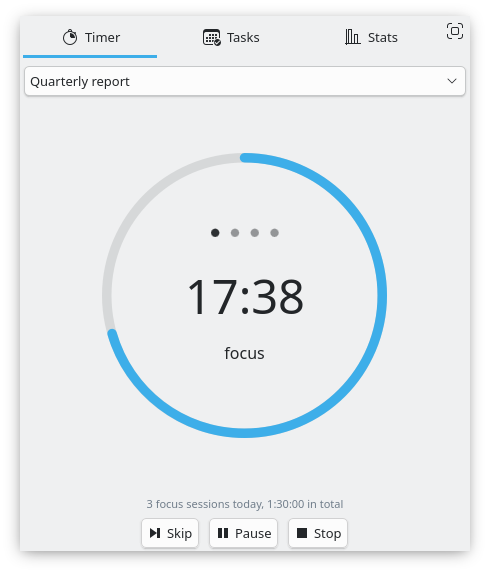
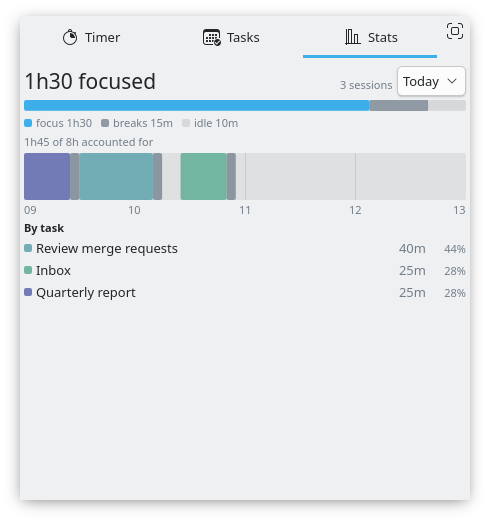
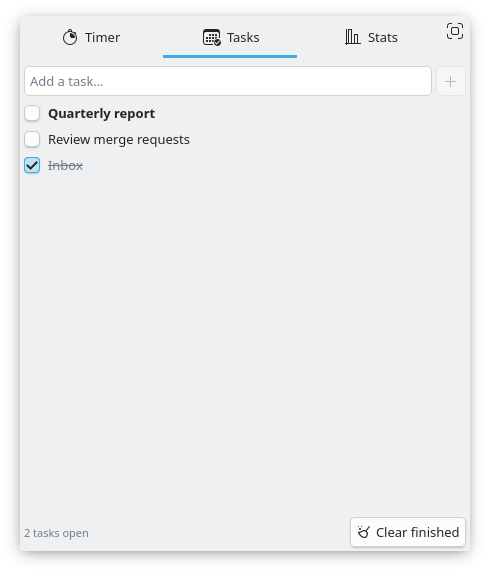
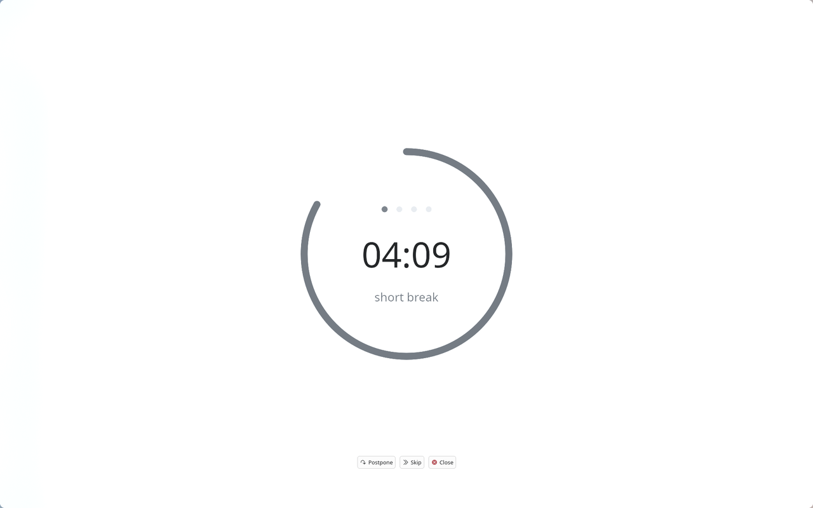

# Fokus for Plasma 6

[](https://store.kde.org/p/2117117/)
[](#license)
[](https://ko-fi.com/divinae4535)

**Work in focused stretches, rest when you've earned it.** A pomodoro and flowmodoro timer for
KDE Plasma 6, with a task list, statistics of your day, and a break overlay that makes you
actually take the break.

| | |
| --- | --- |
|  |  |
| The dial, mid-session | Today drawn as a clock, and the split by task |
|  |  |
| The task list | The break overlay, at stock settings |

### Why you'll like it

- 🍅 **Two ways to work.** Classic pomodoro (25/5/20, 50/10/30, 90/20/30 or your own) or
  flowmodoro: work as long as the flow lasts, and the break is earned from it.
- 🛑 **Breaks you take.** An overlay on every screen, across virtual desktops, optionally blurred,
  with Postpone, Skip and Start; a break that runs over keeps counting.
- ✅ **Tasks and where the time went.** A todo list in the popup; each session counts for the task
  you pick, and today is drawn as a clock with the split by task.
- 🔔 **Your sounds, your scripts.** Four events (focus and break, start and end), each with its own
  notification and sound, a ticking warning, and scripts to run at each.
- 🔄 **Nothing lost.** A running session comes back after a Plasma restart, the downtime
  subtracted.
- 🎨 **Quiet in the panel.** A tomato, a thin ring or a filled wedge, with or without the
  countdown.

Made for a **Wayland** session. X11 is not supported: much of it works there, but some parts do
not; the break overlay on several monitors, for one, does not take clicks.

## Install

### From the KDE Store

Right click the panel > Add or Manage Widgets > Get New Widgets > Download New Plasma Widgets,
search for **Fokus**, or get it from [store.kde.org](https://store.kde.org/p/2117117/).

### From a release

Download the latest `fokus_v<version>.plasmoid` from the repository, then:

```sh
kpackagetool6 -t Plasma/Applet -i fokus_v3.2.0.plasmoid
# or, to upgrade an installed Fokus:
kpackagetool6 -t Plasma/Applet -u fokus_v3.2.0.plasmoid
```

### From source

```sh
git clone https://github.com/divinae/focus-plasmoid.git
cd focus-plasmoid
make install     # first time
make upgrade     # after changes
```

Then add **Fokus** to a panel. Restart Plasma after an upgrade
(`systemctl --user restart plasma-plasmashell`).

One optional dependency: **LayerShellQt** (`layer-shell-qt`, or `qml6-module-org-kde-layershell`
on Debian and Ubuntu). Without it everything works and the break overlay still covers every
screen; it just does not follow a switch to another virtual desktop.

See [CHANGELOG.md](CHANGELOG.md) for what changed between releases. For Plasma 5, the older
version is still on the store: [store.kde.org/p/1308861](https://store.kde.org/p/1308861/).

Using [Glance](https://github.com/divinae/glance-plasmoid)? Fokus is built into it, together with
sit/stand reminders (its settings aren't imported from this widget).

## What it does

**Two ways to work.** Classic pomodoro with configurable focus, short break and long break
lengths — plus presets for 25/5/20, 50/10/30 and 90/20/30, switchable from the panel's
context menu. Or flowmodoro, where you work as long as the flow lasts and the break is
earned from it, at a configurable divisor (a fifth by default).

**A panel that stays out of the way.** Three indicator styles — the tomato frame, a thin
ring, or a filled wedge — with the countdown beside the icon, instead of it while a session
runs, or not at all. Optional bold digits, a custom font, and a flash when a session ends.

**Break overlay.** Covers every screen and stays put across virtual desktops, with an
optional blur, adjustable background opacity, and its own light or dark palette regardless
of the desktop scheme. Postpone, Skip, Close and Start buttons, each optional, and
optionally revealed only on hover. A break that runs past its end keeps counting into the
negative and can repeat its sound until you start the next session.

**Tasks.** A todo list in the popup: add, tick off, reorder, rename in place. The session is
attributed to the task you pick, and switching task mid-session records the stretch you
already worked rather than re-attributing all of it. Deleting a task archives it, so the
sessions recorded against its name keep that name.

**Statistics.** Today drawn as a clock — each session at the hour it happened, focus in the
task's colour, breaks dimmed, gaps left as gaps. Longer periods as bars of time, focus and
break stacked, with a reference line at your working day. Underneath: focus, breaks and
idle, how much of the working day the timer accounted for, and the split by task.

**Notifications and sound.** Focus start, focus end, break start and break end are four
separate events, each with its own notification toggle, sound toggle and sound file, plus
one global volume. A ticking sound can warn that a deadline is approaching.

**Sessions survive a restart.** A running session comes back after a Plasma restart with the
downtime subtracted, since what is stored is the deadline rather than the time left.

**Scripts.** Run something on focus start, focus end, break start, break end or stop.

## Development

| Command | What it does |
| --- | --- |
| `make install` | install the applet (`kpackagetool6 -i`) |
| `make upgrade` | reinstall over an existing copy (`kpackagetool6 -u`) |
| `make uninstall` | remove the applet |
| `make lint` | run `qmllint` over the QML sources |
| `make test` | run the `tests/` suite with `qmltestrunner` |
| `make check` | `lint` + `test` |
| `make package` | build `fokus_v<version>.plasmoid` for upload |

`make package` takes the version from `package/metadata.json`, so the archive
name cannot drift from the plugin version.

The logic that can be tested without a running Plasma lives in
`package/contents/ui/lib/` as plain JavaScript — session state, history, tasks, formatting —
and `tests/` covers it with `qmltestrunner`. Anything needing the applet host is verified by
installing into a throwaway data directory, as below.

Reload after changing QML:

```
make upgrade && systemctl --user restart plasma-plasmashell
```

To try a change without touching the installed copy, install into a throwaway
data directory and open it in its own window:

```
XDG_DATA_HOME=/tmp/fokus-test make install
XDG_DATA_HOME=/tmp/fokus-test plasmawindowed com.dv.fokus
```

`plasmawindowed` writes QML errors to the journal rather than to the terminal, so when
something fails to load:

```
journalctl --user --since "1 min ago" | grep -i qml
```

## Support

If Fokus is useful to you, you can buy me a coffee on [Ko-fi](https://ko-fi.com/divinae4535).

## Bugs and ideas

Report them in [GitHub Issues](https://github.com/divinae/focus-plasmoid/issues): your
distribution, the Plasma version, Fokus's version, and for a problem the widget's log. Do what
goes wrong, then right after:

```sh
journalctl --user -b --since "-15min" | grep -i -E "fokus|plasmashell" > fokus.log
```

Look it over before attaching `fokus.log`.

The code is on [GitHub](https://github.com/divinae/focus-plasmoid). The old
[GitLab project](https://gitlab.com/divinae/focus-plasmoid) is archived, with its earlier issues
and merge requests kept there.

## License

GPL-3.0, see `LICENSE`.
