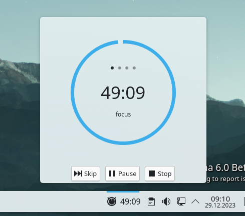

# Fokus plasmoid

Fokus is simple pomodoro KDE Plasma plasmoid.



To install use:
kpackagetool6 -t Plasma/Applet -i package

## Development

| Command | What it does |
| --- | --- |
| `make install` | install the applet (`kpackagetool6 -i`) |
| `make upgrade` | reinstall over an existing copy (`kpackagetool6 -u`) |
| `make uninstall` | remove the applet |
| `make lint` | run `qmllint` over the QML sources |
| `make test` | run the `tests/` suite with `qmltestrunner` |
| `make check` | `lint` + `test` |
| `make package` | build `fokus_v<version>.plasmoid` for upload |

`make package` takes the version from `package/metadata.json`, so the archive
name cannot drift from the plugin version.

Reload after changing QML:

```
make upgrade && systemctl --user restart plasma-plasmashell
```

To try a change without touching the installed copy, install into a throwaway
data directory and open it in its own window:

```
XDG_DATA_HOME=/tmp/fokus-test make install
XDG_DATA_HOME=/tmp/fokus-test plasmawindowed com.dv.fokus
```

Plasma 5
https://www.pling.com/p/1308861/

Plasma 6:
https://www.pling.com/p/2117117/

